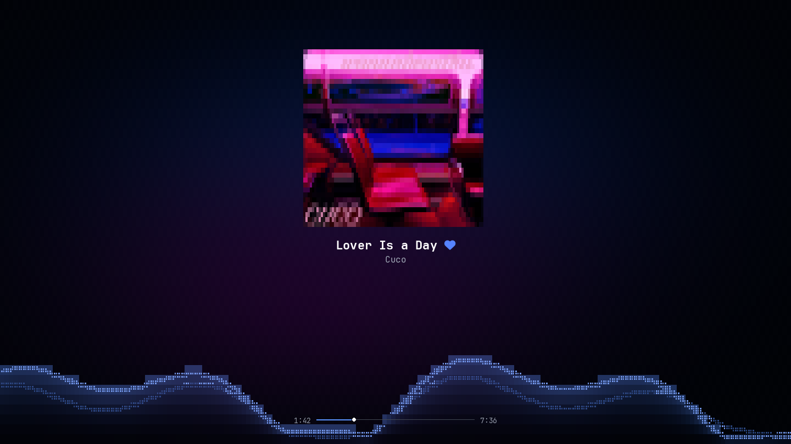

# Kymat

A smooth **144 FPS ASCII / terminal music screensaver** for **Wayland & Hyprland** ([Omarchy](https://omarchy.org/)), inspired by [Sonora](https://github.com/sonora)'s fullscreen player aesthetic.

Kymat reacts in real time to whatever music is playing on your desktop — displaying pixel-art album covers, ambient colors extracted from the artwork, synchronized lyrics with depth-of-field blur, and a live audio soundwave.

---

## Preview

### Synced Lyrics View


### Soundwave View


---

## Highlights

- **Two Visual Modes (`Tab`)**
  - **Lyrics View**: Split-screen layout with large pixel-art lyrics and smooth Gaussian blur on past and upcoming lines.
  - **Soundwave View**: Centered album artwork over a live, double-crest audio wave that reacts to your system audio.
- **Works with Any Music Player**
  - Automatically detects **Sonora**, **Spotify**, **Deezer**, **YouTube Music**, **YouTube** (Brave, Chromium, Firefox), **VLC**, **mpv**, and any MPRIS-enabled player.
  - Fetches synced lyrics from Sonora's local cache or automatically via **LRCLIB** (`lrclib.net`).
- **Adaptive Ambient Theme**
  - Extracts dominant colors from the current album cover to tint the dark radial background glow, heart icon, progress bar, and soundwave.
- **Built for Omarchy & Dual-Monitor Setups**
  - Can run standalone in any terminal or automatically launch on a secondary monitor when Omarchy enters screensaver mode (keeping the classic Omarchy ASCII screensaver on your primary screen).

---

## Installation

### From Source (Arch Linux / Omarchy)

```bash
git clone https://github.com/Margul7803/kymat.git
cd kymat
cargo build --release

install -Dm755 target/release/kymat ~/.local/bin/kymat
install -Dm644 foot-kymat.ini ~/.config/kymat/foot-kymat.ini
install -Dm644 config.toml.example ~/.config/kymat/config.toml
install -Dm644 assets/kymat.desktop ~/.local/share/applications/kymat.desktop
```

---

## Usage

Run `kymat` in any TrueColor terminal (`foot`, `ghostty`, `alacritty`, `kitty`):

```bash
kymat
```

### Controls

| Key | Action |
| --- | --- |
| `Tab` | Switch between **Lyrics View** and **Soundwave View** |
| `r` | Toggle the **Dancing Rat Easter Egg** in the center of the screen |
| `q` / `Esc` | Quit (in normal mode) |
| Any key / Mouse move | Exit screensaver (when launched with `--screensaver`) |

---

## Omarchy Dual-Monitor Screensaver Setup

If you use **Omarchy** with a second monitor connected, you can display the classic Omarchy screensaver on your primary display and **Kymat** on your secondary display:

```bash
install -Dm755 scripts/omarchy-launch-screensaver ~/.local/bin/omarchy-launch-screensaver
install -Dm755 scripts/kymat-screensaver-runner ~/.local/bin/kymat-screensaver-runner
```

Both screensavers wake up and close together as soon as you move the mouse or press a key on either screen.

---

## Configuration

Settings can be managed directly via the CLI or edited in `~/.config/kymat/config.toml`:

```bash
# Open configuration in your default editor ($VISUAL, $EDITOR, or nano/micro/vim)
kymat config edit

# Display the absolute path to your config file
kymat config path

# View current configuration contents
kymat config show
```

### Config File Options (`~/.config/kymat/config.toml`)

```toml
fps = 144
font_size = 12
default_mode = "lyrics" # "lyrics" or "soundwave"
rat_easter_egg = false
audio_sensitivity = 1.15
attack_lambda = 35.0
decay_lambda = 12.0
background_transition_secs = 1.5
layout_transition_secs = 0.6
```

## License

GPL-3.0-or-later
